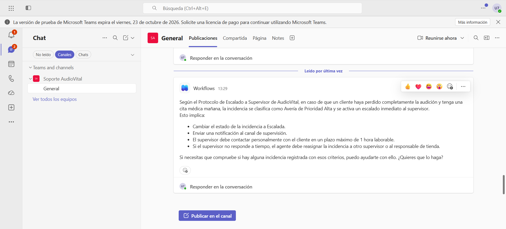

# Gestión de incidencias con Power Platform e IA generativa

Circuito completo de gestión de incidencias de atención al cliente construido sobre **Microsoft Power Platform** y **Azure**, en tres fases:

1. **Automatización:** clasificación con **Azure OpenAI** y escalado por **Microsoft Teams**.
2. **RAG y evaluación:** un asistente que responde **fundamentado en documentación corporativa y citando la fuente** (**Azure AI Search**), y una clasificación medida con casos de prueba.
3. **Operación y gobierno en Azure:** secretos en **Key Vault**, permisos mínimos (**RBAC**), control de costes y diagnósticos en **Log Analytics**, y ciclo de vida completo de la incidencia.

Caso ficticio (**AudioVital**), datos 100 % inventados. Proyecto de portafolio construido, ejecutado, **evaluado** y documentado en un entorno real de Microsoft. No es un sistema en producción: es una solución funcional, evaluada y con una [hoja de ruta para llevarla a producción](#cómo-llevarlo-a-producción).

> **Clasificación en la validación independiente (15 incidencias nuevas):** 80 % de acierto estricto · 100 % en los casos claros · ninguna de las 5 urgentes sin escalar.

📄 **Documento completo de las tres fases:** [`docs/Proyecto_Completo_Gestion_Incidencias_PowerPlatform_IA.pdf`](docs/Proyecto_Completo_Gestion_Incidencias_PowerPlatform_IA.pdf) (49 páginas).

---

## Qué hace

Un agente registra una incidencia describiéndola con sus propias palabras. A partir de ahí:

1. **Dataverse** le asigna el código `INC-0000`, guarda quién la creó y la deja *Abierta*.
2. **Azure OpenAI** (`gpt-4.1-mini`, temperatura 0, salida JSON obligatoria) determina **tipo** y **prioridad** aplicando los criterios de la política interna.
3. **Power Automate** actualiza el registro. Si la prioridad es **Alta**, la marca como *Escalada* y publica en Teams una **tarjeta adaptable** con el botón **«Me encargo»**: el supervisor que la pulsa queda como propietario y la incidencia pasa a *En curso*.
4. Si la clasificación falla, **avisa por Teams** para que alguien la revise a mano.
5. Desde Teams se puede **preguntar en lenguaje natural**: el asistente combina los datos de Dataverse con los **6 documentos de políticas** indexados en Azure AI Search, **cita la fuente** y, si la información no está en los documentos, **lo dice en lugar de inventarla**.
6. Una incidencia **no se puede cerrar sin resolución**: si falta, vuelve a *En curso*; si está, se fecha el cierre y **se avisa por Teams a quien la registró**.
7. Un panel de **Power BI** ofrece la visión agregada.



*El asistente responde según el protocolo de escalado y cita el documento de origen.*

---

## Evolución del proyecto

| | Fase 1 · solución base | Fase 2 · RAG y evaluación | Fase 3 · operación y gobierno |
|---|---|---|---|
| Asistente | Responde de memoria del modelo | Fundamentado en 6 documentos, con cita de la fuente | Sin bucles y con la consulta acotada: respuestas en 8–15 s |
| Clasificación | Temperatura 1, texto libre | Temperatura 0, `json_object`, criterios de la política | Escribe también la fecha de alta |
| Errores | Nadie se entera | Aviso automático en Teams | Diagnósticos en Log Analytics, presupuesto con alertas |
| Secretos | — | Clave en el flujo | **Azure Key Vault** con entidad de servicio y RBAC |
| Ciclo de vida | Alta y escalado | Alta y escalado | Asignación «Me encargo» y cierre con resolución obligatoria |
| Verificación | 4 casos de comprobación | **45 incidencias** evaluadas en 3 pasadas | Pruebas de cada flujo, con errores diagnosticados |

Medir también sirvió para revisar la Fase 1: el acierto de uno de sus casos fue en parte azar, y la rama de escalado **nunca cambiaba el Estado** a *Escalada*, como afirmaba la documentación original. Ambas cosas están corregidas y declaradas en la memoria técnica.

---

## Arquitectura

```
Power Apps ──► Dataverse ──► Flujo 1 · Alta ──────► Azure OpenAI (clasificación)
                  │              ├──► Teams: aviso si la clasificación falla
                  │              └──► Estado = Escalada
                  │                        │
                  │                        ▼
                  │          Flujo 4 · Me encargo ──► Teams: tarjeta adaptable
                  │                        └──► Dataverse: Propietario + En curso
                  │
                  ├──► Flujo 3 · Cierre ──► sin resolución: vuelve a En curso
                  │                    └──► con resolución: Fecha_Cierre + aviso al autor
                  ├──► Power BI
                  │
Teams ──► Flujo 2 · Asistente ──► Dataverse (incidencias recientes)
                  ├──► Azure Key Vault (clave de consulta de AI Search)
                  ├──► Azure AI Search ◄── Blob Storage (6 PDFs) + text-embedding-3-small
                  └──► Azure OpenAI ──► respuesta con fuente citada

Azure OpenAI ──► diagnósticos ──► Log Analytics (KQL) · Presupuesto con alertas
```

| Capa | Tecnología | Función |
|---|---|---|
| Datos | Microsoft Dataverse | Fuente única de verdad; código autonumérico; autor y propietario reales |
| Captura | Power Apps | Formulario de alta, consulta y cierre |
| Orquestación | Power Automate | 4 flujos: alta y clasificación, asistente, cierre y asignación |
| Inteligencia | Azure OpenAI · `gpt-4.1-mini` | Clasificación y generación de respuestas |
| Embeddings | Azure OpenAI · `text-embedding-3-small` | Vectorización de documentos y consultas |
| Base documental | Azure Blob Storage | 6 PDFs de políticas y protocolos |
| Recuperación | Azure AI Search (plan Gratis) | Índice vectorizado y búsqueda híbrida |
| Secretos e identidad | Azure Key Vault · Microsoft Entra ID | Clave en Key Vault, leída por una entidad de servicio con permiso de solo lectura |
| Observabilidad y coste | Azure Monitor · Log Analytics · Cost Management | Métricas, consultas KQL, presupuesto con alertas |
| Interacción | Microsoft Teams | Avisos, tarjeta «Me encargo» y asistente conversacional |
| Analítica | Power BI | Panel interactivo con medida DAX |

---

## Fase 2 · El RAG, paso a paso

**Una vez (indexación):** los 6 PDFs ficticios se suben a Blob Storage; el indexador de Azure AI Search los trocea en **11 fragmentos**, los vectoriza con `text-embedding-3-small` y crea un índice con texto, título y vector (6 documentos, 0 errores).

**En cada pregunta (recuperación + generación):** el Flujo 2 llama a la API REST de AI Search con una **búsqueda híbrida** (palabras clave + vectores). AI Search vectoriza la pregunta con el mismo modelo, sin una llamada extra. Los 8 fragmentos recuperados se pasan a Azure OpenAI con la instrucción de basarse en ellos, citar el documento y decir que no lo sabe si no está.

```json
{
  "search": "<texto del mensaje>",
  "vectorQueries": [
    { "kind": "text", "text": "<texto del mensaje>", "fields": "text_vector", "k": 8 }
  ],
  "top": 8,
  "select": "title,chunk"
}
```

**Por qué RAG y no afinar el modelo:** las políticas cambian. Con RAG basta con reindexar el documento, y cada respuesta se puede comprobar en su fuente; el afinado enseña estilo, no hechos que cambian.

> **Incidente en el entorno desplegado.** El plan Gratis de Azure AI Search limita las consultas con reordenación semántica. La cuota se agotó y el asistente dejó de responder **sin ningún aviso**. Sin reordenación, el protocolo correcto caía del 1.er al 7.º puesto. Se pasó a búsqueda híbrida con 8 fragmentos: la respuesta vuelve a ser correcta, aunque la cita de la fuente es menos precisa. Funciona porque el corpus es pequeño; con cientos de documentos haría falta la reordenación semántica de pago.

---

## Evaluación de la clasificación

El resultado esperado de cada incidencia se fija **antes** de ejecutarla, a partir de los criterios de la política documental.

| Pasada | Incidencias | Acierto estricto | Urgentes sin escalar |
|---|---|---|---|
| v1 | 30 | 27/30 (90 %) | 1 de 11 |
| v2 · tras corregir el prompt | las mismas 30 | 29/30 · 0 regresiones | 0 de 11 |
| **Validación independiente** | **15 nuevas** | **12/15 (80 %)** | **0 de 5** |

La v2 corrigió los dos fallos de la v1 sin empeorar ningún caso, pero sus reglas se escribieron viendo esos casos, así que no sirve para estimar el acierto. Por eso se añadió una **validación con 15 incidencias que no se usaron para ajustar nada**, con texto más realista (sin tildes, mensajes escuetos, una felicitación, peticiones mixtas). Sus tres desviaciones están en casos de frontera donde la propia política es ambigua.

Son resultados sobre un conjunto pequeño redactado por una sola persona: indican que el criterio funciona, no garantizan el comportamiento en producción. Archivos en [`evaluacion/`](evaluacion/).

---

## Fase 3 · Operación y gobierno en Azure

**Seguridad.** La clave de AI Search estaba escrita en el flujo. Ahora vive en **Azure Key Vault** (modelo de permisos RBAC). Para leerla se registró la aplicación `app-audiovital-flujos` en **Entra ID**; su entidad de servicio solo tiene el rol *Usuario de secretos de Key Vault*. Además, el secreto guardado es la **clave de consulta** (solo busca, no puede modificar el índice), y el paso que lo usa tiene **entradas y salidas seguras**, así que no aparece en el historial de ejecuciones. Power Automate no ofrece identidad administrada para este conector; por eso se usa una entidad de servicio con secreto.

**Incidente: bucle de autodisparo del Flujo 2.** Las respuestas tardaban hasta 5 minutos, llegaban duplicadas y aparecían errores 429 (límite de peticiones), aunque el límite del despliegue era alto.

- **Diagnóstico:** el historial de reintentos mostraba el 429; las métricas del recurso, **36,53 millones de tokens en 24 horas**; y la salida del mensaje, que lo enviaba el propio bot (`from.user` vacío). El asistente se respondía a sí mismo.
- **Corrección:** una condición antibucle (si no escribe una persona, el flujo termina) y una consulta a Dataverse acotada a 12 columnas y las 50 incidencias más recientes. La respuesta que se envía al modelo pasó de 247.625 a 48.387 bytes (**−80 %**).
- **Resultado:** una sola respuesta por pregunta, en 8–15 segundos.

**Observabilidad y coste.** Análisis de costes por recurso (octubre: 19,55 €, casi todo Azure OpenAI), **presupuesto de 25 €/mes con alertas** y diagnóstico de Azure OpenAI enviado a **Log Analytics**, donde una consulta KQL muestra cada llamada (embeddings y chat) con su código y su latencia. El bucle se detectó a mano, por la lentitud y las métricas; esta vigilancia se montó después para que la próxima vez avise sola.

**Ciclo de vida de la incidencia.**

- Autor y propietario reales (columnas de sistema *Creado por* y *Propietario*), estados *En curso* y *Pendiente de revisión*, columna *Resolución* y *Fecha_Alta* escrita por el Flujo 1.
- **Flujo 3 · Cierre:** se dispara al pasar a *Cerrada*. Sin resolución, la devuelve a *En curso*; con resolución, escribe la fecha de cierre y avisa por Teams a quien la registró.
- **Flujo 4 · Me encargo:** publica la tarjeta adaptable al escalar, busca en Dataverse al usuario que pulsa el botón (por su UPN) y lo asigna como propietario. La primera prueba falló porque la búsqueda por correo no encontraba al usuario; se diagnosticó y se corrigió.

---

## Lo que no se construyó y límites conocidos

**No construido** (declarado como siguiente paso): recordatorio de escaladas sin asignar fuera de plazo, rama de error que deje la incidencia en *Pendiente de revisión*, retirada del aviso de texto de escalado que llega junto a la tarjeta, roles de seguridad de Dataverse, tabla de registro de ejecuciones y auditoría.

**Límites:**

- Depende de la **capa gratuita** de Azure AI Search; la recuperación sin reordenación semántica **no escala** más allá de un corpus pequeño.
- Evaluación de **45 casos**, redactados y etiquetados por una sola persona.
- Probado con **un solo usuario**: no se ha comprobado qué ocurre si dos supervisores pulsan «Me encargo» a la vez, ni se ha protegido el proceso frente a una acción repetida por un reintento.
- El asistente solo consulta las **50 incidencias más recientes**.
- `gpt-4.1-mini` está en estado *Legacy* y se retira el 14/4/2027.
- Infraestructura sobre crédito de Azure temporal: la solución queda documentada, pero no ejecutable sin pasar a pago por uso.

---

## Cómo llevarlo a producción

Resumen de la hoja de ruta de la memoria de la Fase 3:

1. **Datos personales:** las descripciones pueden contener datos de salud. Antes de tocar datos reales: evaluación de impacto con el equipo legal, recursos en la UE y enviar al modelo solo lo imprescindible.
2. **Identidad y seguridad:** flujos con cuenta de servicio, roles de seguridad de Dataverse por tienda y zona, y directivas de prevención de pérdida de datos aplicadas por el administrador de la plataforma.
3. **Ciclo de vida (ALM):** entornos de desarrollo, pruebas y producción; solución desplegada con pipelines y variables de entorno, con los secretos vinculados a Key Vault.
4. **IA y RAG:** modelo vigente, AI Search de pago con reordenación semántica, indexación programada y la evaluación como prueba de regresión antes de cada cambio.
5. **Operación:** control de errores, alertas sobre errores y latencia, registro de ejecuciones y presupuesto desde el primer día.
6. **Piloto** en dos o tres tiendas, comparando la prioridad de la IA con la del supervisor, antes de desplegar por oleadas.

---

## Contenido del repositorio

| Carpeta | Contenido |
|---|---|
| [`docs/`](docs/) | **Proyecto completo** (Fases 1 a 3, 49 páginas) y las dos memorias técnicas por separado |
| [`capturas/`](capturas/) | Evidencias: Fase 1, [`fase2/`](capturas/fase2/) (29) y [`fase3/`](capturas/fase3/) (45), cada una con su índice |
| [`base-documental/`](base-documental/) | Los 6 documentos internos ficticios indexados en Azure AI Search |
| [`evaluacion/`](evaluacion/) | Conjuntos de evaluación y validación con sus resultados |
| [`datos/`](datos/) | Descripción de los datos ficticios |

---

## Estado

- [x] **Fase 1** — Solución base: clasificación, escalado, asistente y panel
- [x] **Fase 2** — Asistente con conocimiento corporativo (RAG), clasificación robusta y evaluación
- [x] **Fase 3** — Operación y gobierno: Key Vault y RBAC, observabilidad y costes, ciclo de vida completo y hoja de ruta a producción

---

## Autor

**José Rafael Vázquez Silva** · Proyecto personal de portafolio · Power Platform · Azure OpenAI · Azure AI Search
[GitHub](https://github.com/RafaVazquezSilva)

Desarrollado con asistencia de una herramienta de IA para el diseño guiado y la documentación; todas las configuraciones se hicieron, probaron y verificaron en el entorno real.

*Todos los datos, nombres de clientes, documentos y marcas empleados en este proyecto son ficticios y fueron creados exclusivamente con fines de demostración.*
