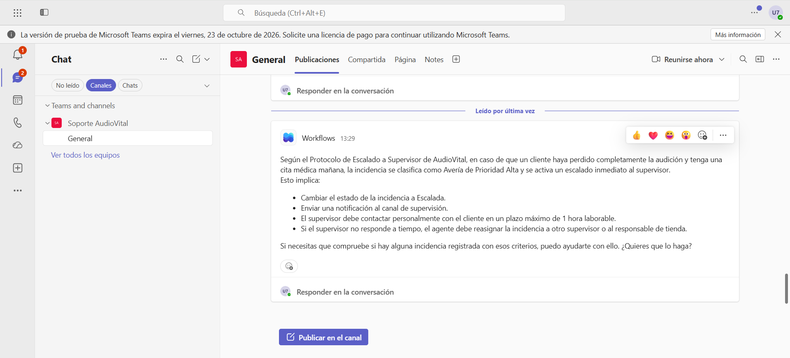
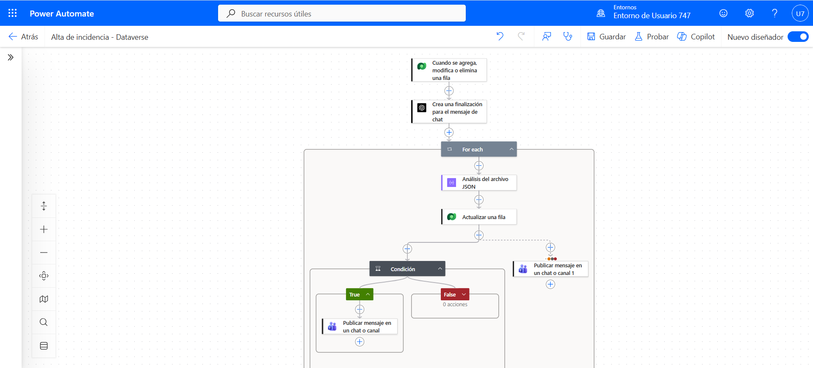

# Gestión de incidencias con Power Platform e IA generativa

Circuito completo de gestión de incidencias de atención al cliente construido sobre **Microsoft Power Platform** y **Azure**: clasificación automática con **Azure OpenAI**, escalado por **Microsoft Teams** y un asistente que responde **fundamentado en documentación corporativa y citando la fuente** (RAG con **Azure AI Search**).

Caso ficticio (**AudioVital**), datos 100 % inventados. Proyecto de portafolio construido, ejecutado, **evaluado** y documentado en un entorno real.

> **Resultado en incidencias nuevas no vistas:** 80 % de acierto estricto · 100 % en los casos claros · **0 escalados perdidos**.

---

## Qué hace

Un agente registra una incidencia describiéndola con sus propias palabras. A partir de ahí, sin intervención humana:

1. **Dataverse** asigna el código `INC-0000` y la crea con Estado *Abierta*.
2. **Azure OpenAI** (`gpt-4.1-mini`, temperatura 0, salida JSON obligatoria) determina **tipo** y **prioridad** aplicando los criterios de la política interna.
3. **Power Automate** actualiza el registro. Si la prioridad es **Alta**, lo marca como *Escalada* y **avisa al supervisor por Teams**.
4. Si la clasificación falla, **avisa por Teams** para que alguien la revise a mano.
5. Desde Teams se puede **preguntar en lenguaje natural**: el asistente combina los datos de Dataverse con los **6 documentos de políticas** indexados en Azure AI Search, **cita la fuente** y, si la información no existe, **lo dice en lugar de inventarla**.
6. Un panel de **Power BI** ofrece la visión agregada.



*El asistente responde según el protocolo de escalado y cita el documento de origen.*

---

## Evolución del proyecto

| | Fase 1 · solución base | Fase 2 · conocimiento corporativo y evaluación |
|---|---|---|
| Respuestas del asistente | De memoria del modelo | Fundamentadas en 6 documentos, con cita de la fuente |
| Clasificación | Temperatura 1, salida de texto, sin criterios | Temperatura 0, `json_object`, criterios documentales |
| Si la clasificación falla | Nadie se entera | Aviso automático en Teams (verificado con fallo forzado) |
| Verificación | 4 casos de comprobación | **45 incidencias** evaluadas en 3 pasadas |

Medir también sirvió para revisar la Fase 1: el acierto de uno de sus casos fue en parte azar, y la rama de escalado **nunca cambiaba el Estado** a *Escalada*, como afirmaba la documentación original. Ambas cosas están corregidas y declaradas en la memoria técnica.

---

## Arquitectura

```
Power Apps ──► Dataverse ──► Flujo 1 ──► Azure OpenAI (clasificación)
                  ▲             ├──► Teams: escalado al supervisor
                  │             └──► Teams: aviso de clasificación fallida
                  ├──► Power BI
                  │
Teams ──► Flujo 2 ┼──► Dataverse (datos de incidencias)
                  ├──► Azure AI Search ◄── Blob Storage (6 PDFs) + text-embedding-3-small
                  └──► Azure OpenAI ──► respuesta con fuente citada
```

| Capa | Tecnología | Función |
|---|---|---|
| Datos | Microsoft Dataverse | Fuente única de verdad; autonumeración de códigos |
| Captura | Power Apps | Formulario de alta y consulta |
| Orquestación | Power Automate | Clasificación, escalado, asistente y avisos de error |
| Inteligencia | Azure OpenAI · `gpt-4.1-mini` | Clasificación y generación de respuestas |
| Embeddings | Azure OpenAI · `text-embedding-3-small` | Vectorización de documentos y consultas |
| Base documental | Azure Blob Storage | 6 PDFs de políticas y protocolos |
| Recuperación | Azure AI Search (plan Gratis) | Índice vectorizado y búsqueda híbrida |
| Interacción | Microsoft Teams | Avisos y asistente conversacional |
| Analítica | Power BI | Panel interactivo con medida DAX |

---

## Evaluación

La clasificación se mide con incidencias cuyo resultado esperado se fija **antes** de ejecutarlas, a partir de los criterios de la política documental.

| Pasada | Incidencias | Acierto estricto | Escalados perdidos |
|---|---|---|---|
| v1 | 30 | 27/30 (90 %) | 1 |
| v2 · tras corregir el prompt | las mismas 30 | 29/30 · 0 regresiones | 0 |
| **Validación independiente** | **15 nuevas** | **12/15 (80 %)** | **0** |

La v2 corrigió los dos fallos de la v1 sin empeorar ningún caso, pero sus reglas se escribieron viendo esos casos, así que no sirve para estimar el acierto. Por eso se añadió una **validación con 15 incidencias que no se usaron para ajustar nada**, con texto más realista (sin tildes, mensajes escuetos, una felicitación, peticiones mixtas). Sus tres desviaciones están en casos de frontera donde la propia política es ambigua.

Archivos de resultados en [`evaluacion/`](evaluacion/).

---

## Decisiones técnicas destacadas

| Situación | Decisión |
|---|---|
| SharePoint y Forms no disponibles en el inquilino | Persistencia en Dataverse y alta con Power Apps |
| Copilot Studio sin créditos | Asistente reconstruido con Power Automate + Teams + Azure OpenAI |
| El modelo decidía la prioridad con su propio criterio | Criterios copiados literalmente de la política en el prompt |
| Clasificación no reproducible | Temperatura 0 y `response_format = json_object` |
| Una incidencia podía quedar sin estado | Estado por defecto en Dataverse **y** escrito por el flujo en una sola actualización |
| **Cuota semántica gratuita agotada en producción** | Búsqueda híbrida (palabras clave + vectores) y más fragmentos recuperados |

> **Incidencia real documentada.** El plan Gratis de Azure AI Search limita las consultas con clasificador semántico. La cuota se agotó y el asistente dejó de responder **sin ningún aviso**. Sin reordenación semántica, el documento relevante caía del 1.er al 7.º puesto. Se pasó a búsqueda híbrida con 8 fragmentos: la respuesta vuelve a ser correcta, aunque la cita de la fuente es menos precisa. La solución funciona porque el corpus es pequeño; no escalaría a cientos de documentos.

> **Nota sobre Copilot Studio:** el agente llegó a crearse con el **servidor MCP de Microsoft Dataverse** conectado como herramienta. La ejecución quedó bloqueada solo por falta de créditos de Copilot en el inquilino: un límite de licencia, no de configuración.

---

## Detalles de implementación

**Búsqueda en la base documental (Flujo 2, paso HTTP):**

```json
{
  "search": "<texto del mensaje>",
  "vectorQueries": [
    { "kind": "text", "text": "<texto del mensaje>", "fields": "text_vector", "k": 8 }
  ],
  "top": 8,
  "select": "title,chunk"
}
```

**Estado coherente con la prioridad (Flujo 1):**

```
if(contains(toLower(json(items('For_each')?['message']?['content'])?['prioridad']),'alta'),
   610150002,   // Escalada
   610150000)   // Abierta
```

El prompt de clasificación completo, el resto de expresiones y la medida DAX están en la memoria técnica.



*Flujo 1: clasificación, condición de escalado y rama de aviso ante fallo (línea discontinua).*

---

## Límites conocidos

- Depende de la **capa gratuita** de Azure AI Search, que ya falló una vez sin avisar; no hay monitorización de errores.
- La recuperación sin reordenación semántica **no escala** más allá de un corpus pequeño.
- Evaluación de **45 casos**, redactados y etiquetados por una sola persona.
- **Clave de API** en lugar de identidad administrada y Key Vault.
- Infraestructura sobre crédito de Azure temporal: la solución queda documentada, pero no ejecutable sin pasar a pago por uso.

La lista completa, con lo que se haría distinto con presupuesto real, está en la memoria técnica.

---

## Contenido del repositorio

| Carpeta | Contenido |
|---|---|
| [`docs/`](docs/) | **Memoria técnica de las Fases 1 y 2** (21 páginas, PDF y Word) |
| [`capturas/`](capturas/) | Evidencias de la Fase 1 y, en [`capturas/fase2/`](capturas/fase2/), 29 capturas de la Fase 2 |
| [`base-documental/`](base-documental/) | Los 6 documentos internos ficticios indexados en Azure AI Search |
| [`evaluacion/`](evaluacion/) | Conjuntos de evaluación y validación con sus resultados |
| [`datos/`](datos/) | Datos ficticios de clientes, productos e incidencias |

---

## Estado y continuación

- [x] **Fase 1** — Solución base: clasificación, escalado, asistente y panel
- [x] **Fase 2** — Asistente con conocimiento corporativo (RAG), clasificación robusta y evaluación
- [ ] **Fase 3** — Operación y gobierno: identidad administrada, Key Vault, roles de Dataverse, registro de ejecuciones y alertas

El mismo patrón se aplicará después a otros dos casos de uso: solicitudes de compra con aprobación por importe y cualificación de clientes potenciales.

---

## Autor

**José Rafael Vázquez Silva** · Proyecto personal de portafolio · Power Platform · Azure OpenAI · Azure AI Search
[GitHub](https://github.com/RafaVazquezSilva)

*Todos los datos, nombres de clientes, documentos y marcas empleados en este proyecto son ficticios y fueron creados exclusivamente con fines de demostración.*
